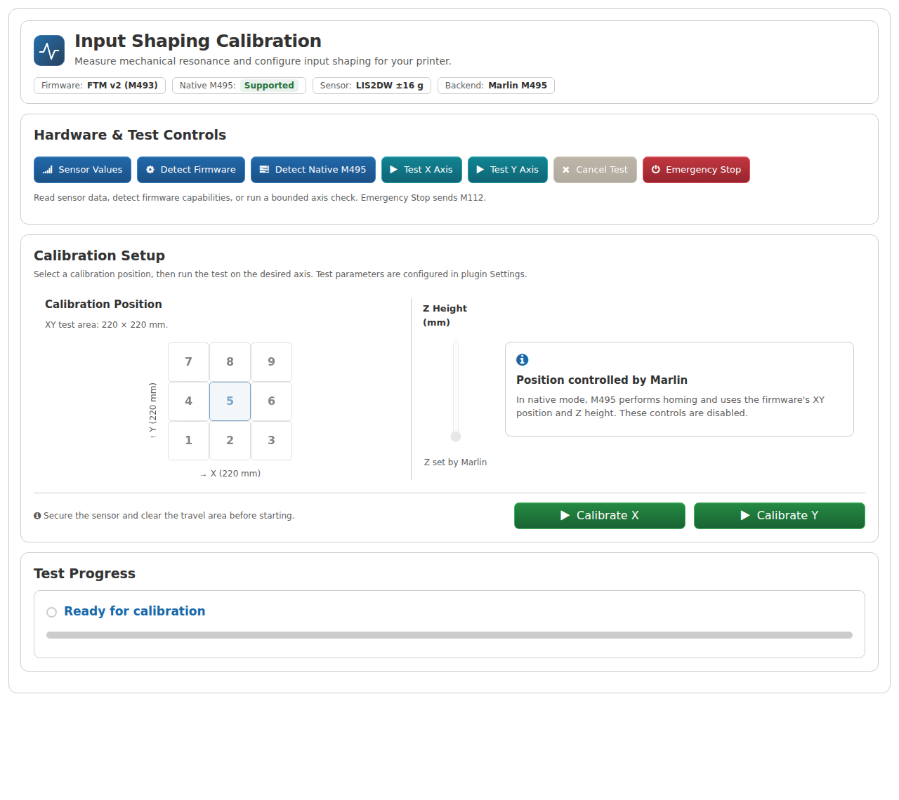
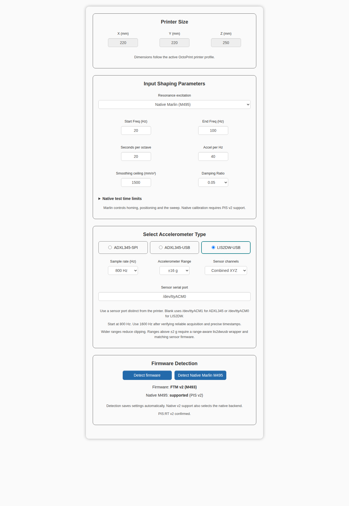
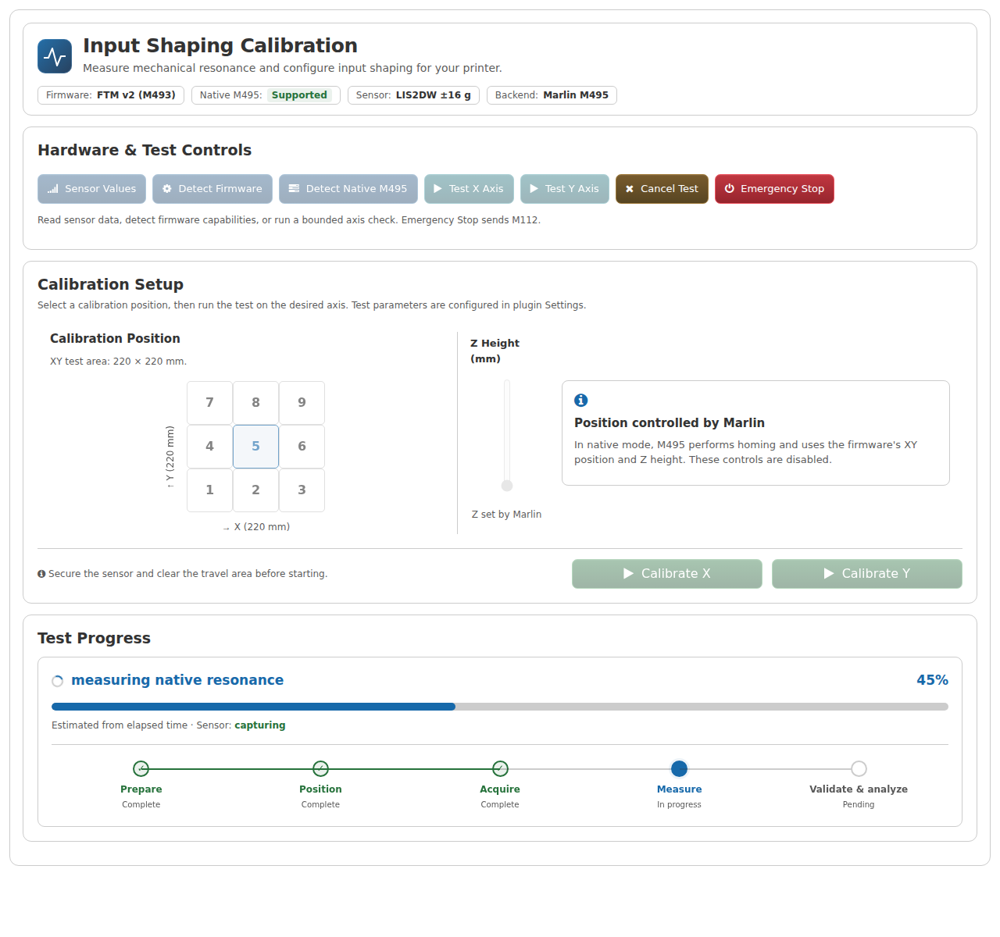
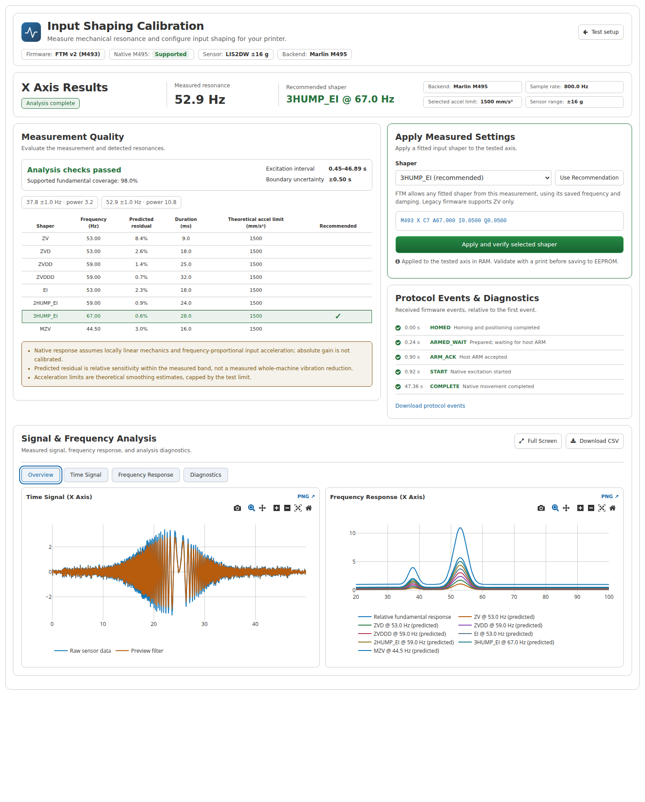
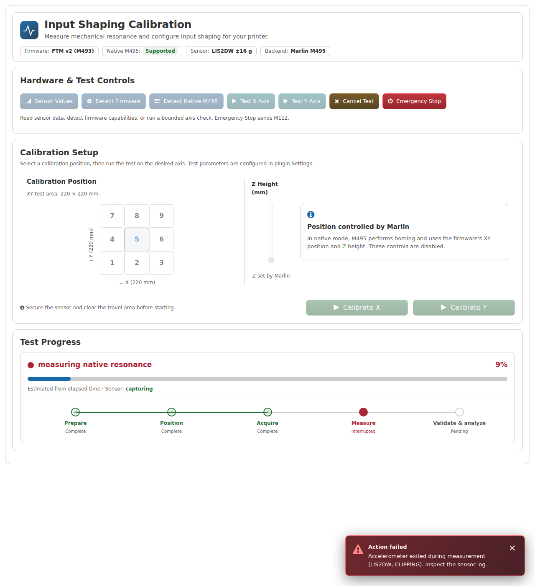
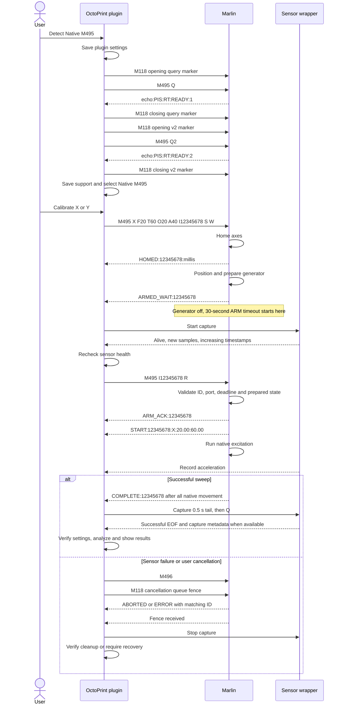

# OctoPrint-PInput-Shaping


**Pinput Shaping** lets you run input shaping tests from OctoPrint with an
ADXL345 or LIS2DW accelerometer. Test X and Y, compare the shapers and apply
the result to Marlin from the same tab.

I use **Native Marlin M495** with my
[`c13_octoprint` branch](https://github.com/navaismo/Marlin_bugfix_2.1_E3V3SE/tree/c13_octoprint).
Marlin handles the movement; the plugin records the sensor, analyzes the
measurement and shows the shaper settings. The software-generated test is
still available for builds without the native integration.



The screenshots show the current UI with sample data.

## Table of Contents

- [Features](#features)
- [Shaper Algorithms Supported](#shaper-algorithms-supported)
- [Accelerometers](#accelerometers)
- [Hardware Setup](#hardware-setup)
  - [ADXL345 SPI](#adxl345-spi)
  - [ADXL345 USB](#btt-adxl345-usb-mellow-fly-adxl345usband-maybe-others-adxl-based-rpi2040)
  - [LIS2DW USB](#btt-lis2dw-usb)
- [Dependencies Installation](#dependencies-installation)
- [Marlin Setup](#marlin-setup)
- [Plugin Installation](#plugin-installation)
- [Settings](#settings)
- [Using the Plugin](#using-the-plugin)
- [Results](#results)
- [Errors and Logs](#errors-and-logs)
- [M495 Communication](#m495-communication)
- [Development](#development)
- [License](#license)
- [Disclaimer](#disclaimer)

## Acknowledgments

- Thanks to [lsellens](https://github.com/lsellens) for the cleanup, improvements and testing.
- Based on [`adxl345spi`](https://github.com/nagimov/adxl345spi) by [@nagimov](https://github.com/nagimov).
- Thanks to [@thosoo](https://github.com/thosoo/) for the RP2040 firmware and USB ADXL345 wrapper.
- Inspired by Klipper's input shaping approach.

## Features

- Native Marlin M495 tests for X and Y, with sensor capture synchronized after homing.
- ADXL345 SPI, ADXL345 USB and LIS2DW USB support.
- Sensor rate, channels and USB port in Settings; selectable LIS2DW range.
- A numbered XY grid and Z height for software tests. Native tests use Marlin's position.
- Signal and frequency graphs, shaper comparison and downloadable measurements.
- Apply and read back the selected shaper with `M493`, or ZV with legacy `M593`.
- Progress stages, error details and logs for each test.

## Shaper Algorithms Supported

| Shaper      | Description            |
|-------------|------------------------|
| ZV          | Zero Vibration         |
| ZVD         | Zero Vibration and Derivative |
| ZVDD        | Zero Vibration, Derivative and Double Derivative |
| ZVDDD       | Zero Vibration and three derivatives |
| MZV         | Modified ZV            |
| EI          | Extra Insensitive      |
| 2HUMP_EI    | 4-Impulse EI           |
| 3HUMP_EI    | 5-Impulse EI           |

The eight shapers are available with the reviewed c13 FTM configuration.
Legacy `M593` builds can apply ZV. Suggested acceleration limits are smoothing
estimates; check the result with a print before saving it.

## Accelerometers

| Brand       | Model                  |
|-------------|------------------------|
| Creality    | [ADXL345 SPI](https://es.aliexpress.com/item/1005007493583778.html)            |
| BigTreeTech | [BTT-ADXL345](https://es.aliexpress.com/item/1005007518562508.html)            |
| BigTreeTech | [BTT-S2DW](https://es.aliexpress.com/item/1005007518562508.html)      |
| Mellow Fly  | [Fly-ADXL345](https://es.aliexpress.com/item/1005008779305652.html)           |

Use the firmware and wrapper for your board. Klipper sensor firmware does
not speak the same protocol as these wrappers.

# Hardware Setup

## ADXL345-SPI
1.- Get any ADXL345 model that you like. In my case I bought it in [AliExpress](https://es.aliexpress.com/item/1005007493583778.html) the one with USB C termination.

2.- The pinout of the sensor is:
<div align="center">
<a href=""></a>
</div>


USB-C:

    RED: SDO

    BLACK: SDA

    PURPLE: VCC (3.3V)

    YELLOW: GND

    ORANGE: SCL

    BLUE: CS

Source: https://www.reddit.com/r/klippers/comments/1e5ocz5/guide_hooking_up_your_creality_adxl345gsensor_to/?rdt=59734

3.- Build a cable to connect the sensor into the Raspberry Pi. In my case i cut in the half and solder the cables to Dupont jumpers to connect it into the board.

4.- The jumpers that I used are 40cm long so I needed to attach another jumpers to make the cable longer and used a case to hold the jumpers to avoid disconnections, so at the end I have a cable around 90cm long make sure you make yours long enough to move safely with your printer..

<div align="center">
<a href=""></a>

<br>

<a href=""></a>
</div>


5.- Connect the Sensor to the Raspberry Pi following the Diagram below:
<div align="center">
<a href=""></a>
</div>

<br>
6.- To Hold the sensor into the Head and Bed you can use your preferred 3D Models, for my Ender 3 V3 SE I use these models:

* Head Bracket: https://www.printables.com/model/919687-g-sensor-bracket-for-ender3-v3-se/files

* Modified Cable Holder to fit 6-Dupont jumpers based on: https://www.printables.com/model/938904-creality-ender-3-v3-ke-se-g-sensor-cable-holder-v1

* Modified Case for 6-Dupont Jumpers based on: https://www.printables.com/model/904964-connector-housing-dupont-6pin-12mm/files

You can find the models in the STL folder along with the 3mf project:


<div align="center">
<a href=""></a>
</div>


7.- Place the sensor in the Head.
<div align="center">
<a href=""></a>
</div>


8.- Place in the Bed.

<div align="center">
<a href=""></a>
</div>


<br>

## GY-291 ADXL345 Variant.

The [GY-291](https://es.aliexpress.com/item/1005008142481700.html) has:
```
* A 10kΩ resistor connected between CS and VCC (3.3V).
* That means that the CS pin is always HIGH by default → forced I2C mode.
* Even if in your sketch you lower CS to LOW, the resistor pulls to HIGH, that's why the ADXL345 never switches to SPI mode.

To make work the SPI mode you need to remove the resistor.
```

#### Source: @jusebago user reported the solution in the [Octoprint Forum](https://community.octoprint.org/t/octoprint-pinput-shaping-a-plugin-to-test-input-shaping-with-marlin/63089/10)

<br>

### Wrapper Automatic Dependencies installation
SSH into your Raspberry Pi save and run the script `Octo-deps-install-ADXLSPI.sh` located in the bash folder:

```bash
sudo bash bash/Octo-deps-install-ADXLSPI.sh
```

Verify that you can read values from the Sensor
```bash
sudo adxl345spi -f 5
```
Output:
```bash
Press Q to stop
time = 0.000, x = -0.016, y = 0.039, z = 1.008
time = 0.200, x = 0.000, y = 0.039, z = 0.969
time = 0.400, x = -0.047, y = 0.055, z = 1.000
time = 0.600, x = 0.000, y = 0.039, z = 1.008
time = 0.801, x = -0.070, y = 0.094, z = 1.023
5 samples read in 1.04 seconds with sampling rate 4.8 Hz
```
<br>


## BTT-ADXL345-USB, Mellow Fly-ADXL345USB(and maybe others ADXL based RPi2040)

Thanks to user [@thosoo](https://github.com/thosoo/) for creating the Firmware for the RPI2040 and the wrapper to work with the variants of the USB ADXL345 connected to a RPi2040.
You can download [from his repo](https://github.com/thosoo/adxl345usb), or from the folder `FW_RPi2040` the uf2 file and do the following to install into your Device:

  - Hold the `BOOT` button from the board.
  - Connect the Board to your machine while keeping pressing the `BOOT` button.
  - Wait for your computer to show the new Storage Device and release the button.
  - Mount and Open the Device.
  - Copy the Downloaded `Firmware.uf2` file (Or your compiled version `Firmware.uf2`) to the Device.
  - When it finish the copy the device will unmount automatically, means the RPi2040 is rebooting.
  - Disconnect the Device from your computer.
  - Connect the device to your Raspberry Pi Running Octoprint(or the device running OctoPrint).

### Wrapper Automatic Dependencies installation
SSH into your Raspberry Pi save and run the script `Octo-deps-install-ADXLUSB.sh` located in the bash folder:

```bash
sudo bash bash/Octo-deps-install-ADXLUSB.sh
```

Verify that you can read values from the Sensor
```bash
adxl345usb -f 5 -p /dev/ttyACM1
```
Output:
```bash
Press Q to stop
time = 0.000, x = -0.016, y = 0.039, z = 1.008
time = 0.200, x = 0.000, y = 0.039, z = 0.969
time = 0.400, x = -0.047, y = 0.055, z = 1.000
time = 0.600, x = 0.000, y = 0.039, z = 1.008
time = 0.801, x = -0.070, y = 0.094, z = 1.023
5 samples read in 1.04 seconds with sampling rate 4.8 Hz
```

<br>

## BTT-LIS2DW-USB

To Hold the sensor into the Head and Bed you can use your preferred 3D Models, for my Ender 3 V3 SE I use these models:

* Modified LIS2DW Case: https://www.printables.com/model/1049353-btt-s2dwadxl345-case/files

<div align="center">
<a href=""></a>
</div>

<br>

* LIS2DW No Screw Cover: https://www.printables.com/model/1167157-no-screws-cover-for-btt-s2dwadxl345-case/files

<div align="center">
<a href=""></a>
</div>
You can find the models in the STL folder along with the 3mf project:

<br>
Place the sensor in the Head.
<div align="center">
<a href=""></a>
</div>


Place in the Bed.

<div align="center">
<a href=""></a>
</div>

<br>

Use the current **main** branch of my
[LIS2DWUSB repo](https://github.com/navaismo/lis2dwusb). It includes protocol 2,
device timestamps and selectable ±2/4/8/16 g ranges. Update **both** the
RP2040 firmware and the wrapper on your Raspberry Pi.

### Build and copy the sensor firmware

With PlatformIO installed, run:

```bash
git clone --branch main https://github.com/navaismo/lis2dwusb.git
cd lis2dwusb
git checkout --detach cc660288df4aed9c7106623c12f2587ed6314a65
pio run -e btt_lis2dw
```

That is the main-branch revision used by this plugin's installer. The UF2 is
generated at `.pio/build/btt_lis2dw/firmware.uf2`. Use this newly built file;
the old copy in this plugin's `FW_RPi2040` folder is not the updated firmware.

1. Hold the sensor's **BOOT** button while connecting it to your computer.
2. Release BOOT when the RP2040 storage device appears.
3. Copy the generated `firmware.uf2` onto that device. It disconnects when the board restarts.
4. Connect the sensor to the Raspberry Pi running OctoPrint.

Building the UF2 does not copy it to the sensor. One firmware image supports
all four ranges; choose the range later in the plugin's Settings.

### Install or update the wrapper

On the Raspberry Pi, run the LIS2DW installer from this plugin's checkout:

```bash
sudo OCTOPRINT_USER=pi bash bash/Octo-deps-install-LIS2DW.sh
```

Replace `pi` with the account running OctoPrint. The installer downloads the
new main-branch revision, compiles the wrapper on the Pi and installs it in
`/usr/local/bin`. It does not flash the sensor. Restart OctoPrint afterward
so it picks up the `dialout` group membership.

If you already have the updated sensor repository on the Pi, you can use:

```bash
make -C Linux_Wrapper
sudo make -C Linux_Wrapper install
/usr/local/bin/lis2dwusb -h
```

Run those commands from the sensor repository root, with its `include/`
folder present. Build on the Pi instead of copying a Linux binary from a PC;
an x86 binary will not run on an ARM Raspberry Pi. The help must list `-r`
and the four ranges.

Check the sensor before using it in the plugin. Replace the port if needed,
and choose a new filename each time:

```bash
lis2dwusb -p /dev/ttyACM0 -f 800 -r 16 -d 10 -s /tmp/lis2dw-check.csv
echo "Exit code: $?"
cat /tmp/lis2dw-check.csv.meta.json
```

Look for `verified complete`, exit code `0` and `valid: true`. At ±16 g the
metadata should show `range_g: 16` and `counts_per_g: 2048`. The CSV is
already in g. Start with **800 Hz / ±16 g**; try 1600 Hz after checking that
your setup completes captures without errors. There is no automatic rate
or range fallback.

## Dependencies Installation

Run the matching installer from this plugin's checkout on the Raspberry Pi:

| Sensor | Command |
| --- | --- |
| ADXL345 SPI | `sudo OCTOPRINT_USER=pi bash bash/Octo-deps-install-ADXLSPI.sh` |
| ADXL345 USB | `sudo OCTOPRINT_USER=pi bash bash/Octo-deps-install-ADXLUSB.sh` |
| LIS2DW USB | `sudo OCTOPRINT_USER=pi bash bash/Octo-deps-install-LIS2DW.sh` |

Replace `pi` with your OctoPrint account. Keep the complete `bash/` folder;
the installers share `install-common.sh`. SPI needs GPIO access through
`sudo -n`; USB sensors use the serial group. Read the script before running it.

The ADXL wrappers use a fixed ±16 g range. The pinned ADXL USB firmware has
a known limitation: `F=` changes its polling rate, but its sensor ODR stays
at 100 Hz. Verify or update that firmware before trusting high-rate captures.
The plugin rate selector cannot fix the sensor's ODR. See the
[sensor compatibility notes](docs/firmware-contract.md#sensor-installation-and-remaining-limitations)
for the acquisition checks and remaining hardware limitations.

## Marlin Setup

### Native Marlin M495

Use my **Marlin bugfix-2.1.x fork**, branch
[`c13_octoprint`](https://github.com/navaismo/Marlin_bugfix_2.1_E3V3SE/tree/c13_octoprint),
for the native workflow. It has the `RESONANCE_TEST` integration and the
M495 PIS v2 events needed to synchronize the sensor with the test.

In your board's `Configuration_adv.h`, enable these options and compile
your normal firmware environment:

```cpp
#define EMERGENCY_PARSER
#define RESONANCE_TEST
#define PINPUT_RESONANCE_EVENTS
```

Keep your printer's input-shaping and FT Motion configuration. `RESONANCE_TEST`
must be enabled in the firmware you actually install; having the source on
that branch is not enough. `PINPUT_RESONANCE_PROGRESS` is optional.

After installing the firmware, use **Detect Firmware**, then **Detect Native
M495** in the plugin. Detection runs only when you press the buttons and saves
the result in Settings. Detecting v2 also selects and saves **Native Marlin
(M495)** as the backend. Repeat detection after reconnecting the printer.

During a native calibration, Marlin homes and chooses its own XY position
and Z height. The plugin's position controls are disabled. The sensor starts
only after `ARMED_WAIT`; Marlin waits for the plugin's ARM before exciting
the axis. See the [communication diagram](#m495-communication).

### Other Marlin forks

If your build already has native M495 resonance generation, use the
[PIS v2 patch and instructions](docs/patches/README.md). The patch targets a
specific upstream `bugfix-2.1.x` revision; older versions may need a port.
It includes the events, host-arming barrier, cancellation hooks and C++ tests.
It does not contain my printer configuration. Do not apply it to c13 again.

Native calibration needs a `READY:2` reply to `M495 Q2`. Plain upstream M495
or PIS v1 is not enough. The software-generated backend remains available;
FTM uses `M493`, while supported legacy builds use ZV through `M593`.
The [firmware contract](docs/firmware-contract.md) lists the reviewed
configuration and shaper compatibility.

## Plugin Installation

Use OctoPrint's **Plugin Manager → Get More → From URL** with the archive for
the branch you want to install. For this work:

```text
https://github.com/navaismo/Octoprint-Pinput_Shaping/tree/main
```
Or download the Zip rin Relase Section of the repo.

You can also upload a source archive in Plugin Manager. Restart OctoPrint
after installation, then reload the browser with **Ctrl+F5**. This installs
the plugin; the sensor wrapper and firmware are separate steps above.

For local development, use the Python environment where OctoPrint is installed:

```bash
python -m pip install -e '.[test]'
```

## Settings

Open **Settings → Pinput Shaping**. Pick your sensor, port and test backend,
then save. The detection buttons also save the displayed plugin settings
before checking the printer.



| Setting | What to use it for |
| --- | --- |
| Resonance excitation | Choose **Native Marlin (M495)** for the c13 workflow. Software mode keeps its own acceleration and duration controls. |
| Start / End Freq | Native mode sends these as M495 F/T. The defaults are 20–60 Hz. In software mode they select the band to analyze. |
| Seconds per octave | Native sweep speed. Default: 20 s/octave. A wider frequency range takes longer. |
| Accel per Hz | Native M495 A parameter. Default: 40. Increase only after checking your machine and capture. |
| Smoothing ceiling | Caps the suggested shaper acceleration. It does not set Marlin's native sweep acceleration. |
| Damping Ratio | Used when fitting the shapers. Default: 0.05. |
| Native test time limits | Preparation, maximum capture and cancellation timeouts. Leave the defaults unless your test needs more time. |
| Accelerometer type | Select ADXL345 SPI, ADXL345 USB or LIS2DW USB. |
| Sample rate | ADXL: 800/1600/3200 Hz, default 3200. LIS2DW: 800/1600 Hz, default 800. |
| Accelerometer Range | LIS2DW only: ±2/4/8/16 g. New settings use ±16 g; existing saved settings keep their previous range. |
| Sensor channels | **Combined XYZ** is useful when the sensor is not aligned with the printer axis. You can also select one sensor channel. |
| Sensor serial port | Use the sensor's port, preferably `/dev/serial/by-id/...`, never the printer's port. Blank uses ACM1 for ADXL USB or ACM0 for LIS2DW. SPI ignores this field. |

Printer dimensions come from the active OctoPrint printer profile. Fix that
profile if the displayed dimensions are wrong.

## Using the Plugin

1. Mount the sensor firmly on the part that moves for the axis: the toolhead
   for X, and the bed for Y on a bed-slinger. Leave enough cable for travel.
2. Press **Detect Firmware**, then **Detect Native M495**. The header shows
   the detected firmware, native support, sensor and selected backend.
3. Use **Sensor Values** for a short stationary capture. It shows the first
   five samples and the captured sample count below **Test Progress**.
4. Press **Calibrate X** or **Calibrate Y** and confirm the movement. In native
   mode, Marlin controls homing and test position. In software mode, choose a
   numbered grid cell and Z height first; use at least 10 mm of clearance.
5. Watch **Test Progress**. Axis-check messages and error details appear
   directly below it. Results open when a complete capture passes analysis.

**Test X Axis / Test Y Axis** are short movement checks, separate from
resonance calibration. They can home and move the printer. Coordinate modes
are prepared by the test; there is no separate Prepare button.



| Stage or response | What is happening |
| --- | --- |
| Preparing | The plugin checks the settings and sensor launch configuration. |
| Homing / positioning | Marlin moves to its test position. Native sensor capture is still off. |
| ARMED_WAIT / starting capture | Marlin is ready and waiting. The plugin starts the sensor and checks that new timestamped samples arrive. |
| Arming native sweep | The plugin sends ARM. Marlin accepts it with ARM_ACK, then sends START before excitation. |
| Measuring | The sensor records the sweep. A percentage may be estimated; it is not proof that motion has completed. |
| Stopping / validating / analyzing | COMPLETE was received. The plugin records a short tail, stops the sensor and checks the data. |
| Complete | The results are ready. Review them before applying anything. |

**Cancel Test** requests cancellation and waits for the printer to stop before
cleanup. **Emergency Stop** sends `M112`; use it when an immediate shutdown
is needed. Neither button replaces access to the printer's physical stop.

## Results



- **Axis Results** shows the measured resonance and recommended shaper.
- **Measurement Quality** shows coverage, alignment and detected peaks.
- The table compares the fitted shapers. The recommended row stays marked
  even when you select another candidate.
- **Apply Measured Settings** previews the command for your selection.
  **Use Recommendation** returns to the suggested shaper. The apply button
  sends it to the tested axis and reads it back; it does not save EEPROM.
- **Overview**, **Time Signal**, **Frequency Response** and **Diagnostics**
  switch the graphs and downloads. Protocol events show what Marlin reported.

With FTM, you can apply any fitted candidate from that measurement. Legacy
firmware is limited to ZV. A diagnostic result without a valid recommendation
keeps application disabled. Test the result with a print before saving it
to EEPROM yourself.

Use **Test setup** to go back and **View results** to reopen the measurement.
A new calibration or printer reconnect invalidates the previous result.

## Errors and Logs



Errors open a red popup and mark the interrupted progress stage in red.
Close the popup to keep working; **View details** below Progress opens it
again. Failed runs keep their session ID and available diagnostic downloads.

| Message | What to check |
| --- | --- |
| CLIPPING | Sensor range, mounting and test acceleration. For LIS2DW, check the selected range and matching firmware. |
| BUFFER_OVERFLOW or missing samples | USB connection, host load and sampling rate. Try an explicit 800 Hz setting after investigating the failure. |
| No new samples / startup failed | Sensor port, permissions, wrapper installation and sensor firmware. |
| M495 unsupported / PIS v1 | Install a build with the v2 integration or use software mode. |
| ARM_TIMEOUT | The sensor did not become ready in time. Marlin does not start the sweep. |
| Restore saved settings | Check that the same printer is stopped, then use recovery. Do not start another test until it succeeds. |

The plugin log is normally `~/.octoprint/logs/Pinput_Shaping.log`. It records
commands sent, firmware events, capture errors and analysis results, including
the recommended shaper and the other fitted candidates.

Each run also has files under
`~/.octoprint/data/Pinput_Shaping/runs/<session>/`: the capture CSV, sensor log,
protocol events and analysis diagnostics. LIS2DW includes verified sensor
metadata. Protocol times are host receive times; they are not the sensor's
sample clock or Marlin's clock.

## M495 Communication

This UML sequence shows detection and a native calibration. The first query
is **`M495 Q`**, which asks for protocol 1; **`M495 Q1` is not accepted**.
The second query, **`M495 Q2`**, checks host-arming support. Each query is
bracketed by its own M118 markers so an old reply cannot enable a new session.



All firmware events above use the `echo:PIS:RT:` prefix. If ARM never
arrives, Marlin sends `ERROR:<id>:ARM_TIMEOUT` and never starts excitation.
Once ARM has been sent, a sensor failure requests M496 even if START has
not reached OctoPrint yet. There are no automatic movement retries.

[PlantUML source](docs/diagrams/m495-host-arming.puml) ·
[Full native protocol](docs/native-m495.md) ·
[Patch for other Marlin builds](docs/patches/README.md)

## Development

```bash
python -m pytest -q
node tests/test_frontend.js
PINPUT_FIRMWARE_ROOT=/path/to/Marlin_c13_octoprint python -m pytest -q tests/test_c13_contract.py
```

Tests use simulated printers and sensor data. They do not replace a test on
your machine. Build a source archive with `python setup.py sdist`.

## License

GPLv3 © [@navaismo](https://github.com/navaismo)

## Disclaimer

**BAU:**<br>
THE SOFTWARE IS PROVIDED "AS IS", WITHOUT WARRANTY OF ANY KIND, EXPRESS OR IMPLIED, INCLUDING BUT NOT LIMITED TO THE WARRANTIES OF MERCHANTABILITY, FITNESS FOR A PARTICULAR PURPOSE AND NONINFRINGEMENT. IN NO EVENT SHALL THE AUTHORS OR COPYRIGHT HOLDERS BE LIABLE FOR ANY CLAIM, DAMAGES OR OTHER LIABILITY, WHETHER IN AN ACTION OF CONTRACT, TORT OR OTHERWISE, ARISING FROM, OUT OF OR IN CONNECTION WITH THE SOFTWARE OR THE USE OR OTHER DEALINGS IN THE SOFTWARE.

**TL;DR:**<br>
If your house burns down because this app malfunctioned, you cannot sue me.
